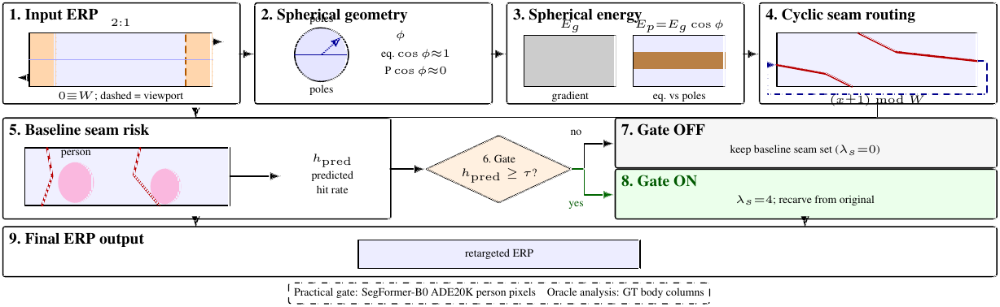
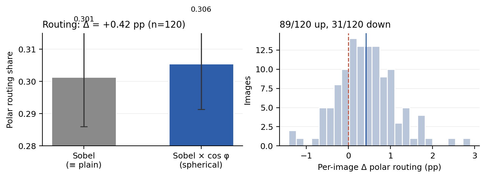
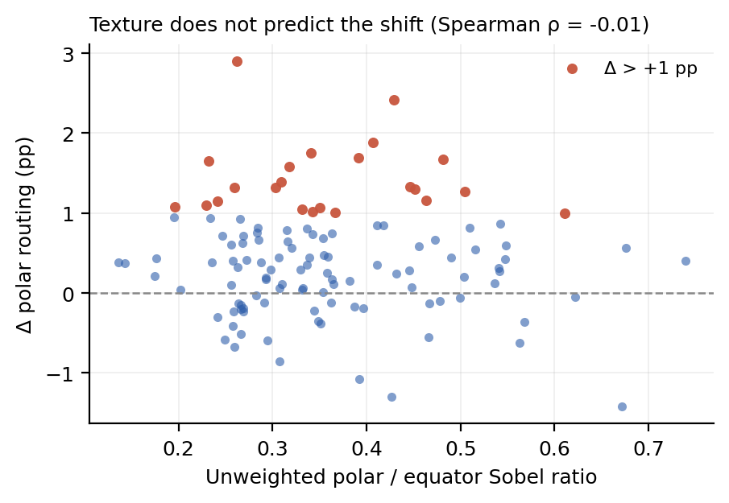
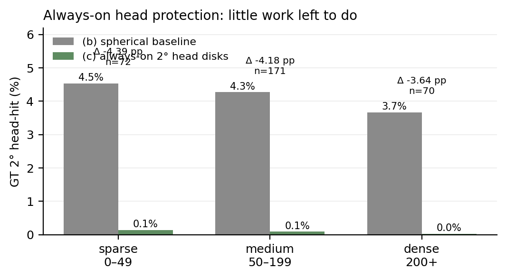
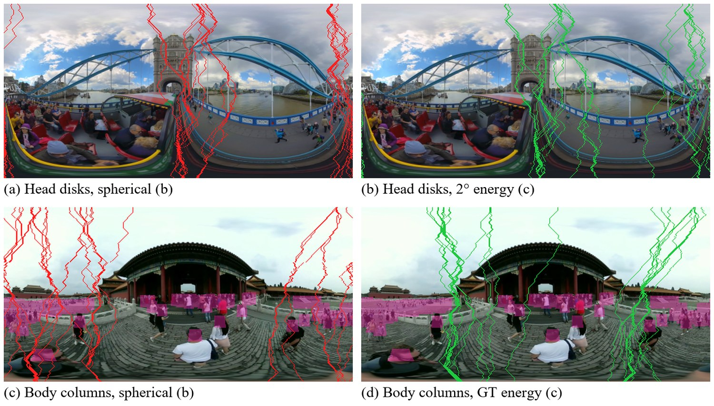
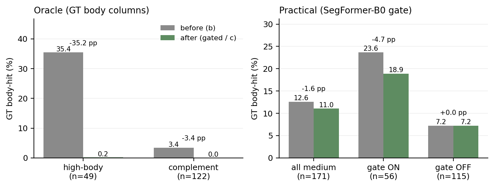
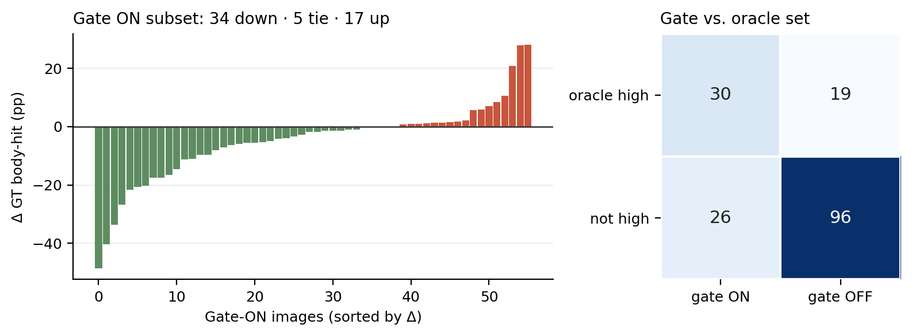
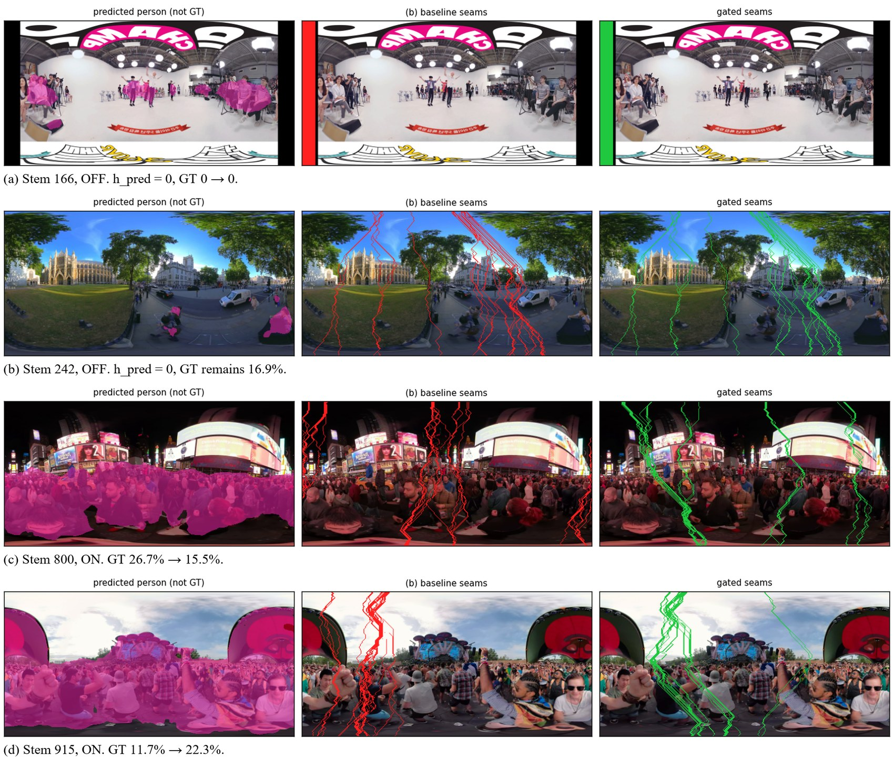
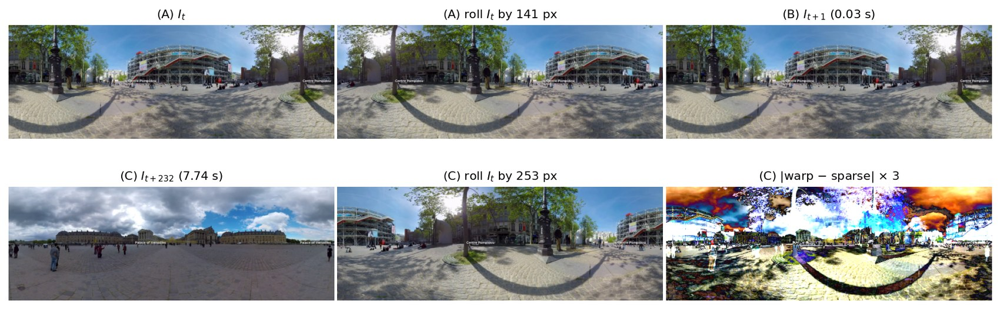

[](https://amictconf.com/index.html)

# Content-Conditioned Cyclic Seam Carving for Equirectangular Panoramas

Official implementation of **"Content-Conditioned Cyclic Seam Carving for Equirectangular Panoramas"**,
accepted at the *3rd International Conference on Advances in Machine Intelligence and Cybersecurity
Technologies (AMICT 2026)*, Labuan, Malaysia, 12–13 November 2026.

**Talal Ahmad**<sup>1</sup> · **Husnain Abid**<sup>2</sup> · **Ghulam Arbi**<sup>3,\*</sup>

<sup>1</sup>Department of Computer Engineering, Bahauddin Zakariya University, Multan, Pakistan ·
<sup>2</sup>Department of Computer Science, University of South Wales, UK ·
<sup>3</sup>Department of Computer Science, University of Science and Technology of China, China

\*Corresponding author — [arbi@mail.ustc.edu.cn](mailto:arbi@mail.ustc.edu.cn)

---

## Overview

Equirectangular (ERP) 360° video is stored at 4K–8K for the full sphere while a viewer sees only a
viewport, so content-aware retargeting can shrink the raster **before** any viewport is extracted.
Seam carving is the natural tool, but an ERP breaks the planar assumptions:

- a vertical seam must be able to **wrap** across the 0/W cut, because a viewport can straddle it;
- a pixel step near the pole covers less sphere than the same step at the equator, so energy should
  be **latitude-weighted**;
- class-agnostic energy happily cuts a person who happens to sit on a low-energy corridor.

This repository implements all three pieces and the finding that ties them together:

| Ingredient | Applies to | Why |
|---|---|---|
| **Cyclic seam routing** — DP over `{x-1, x, x+1} mod W` | every image | topology of the sphere, not of the content |
| **Spherical energy** — `E_p = E_g · cos φ` | every image | latitude-dependent area element |
| **Content-conditioned semantic energy** — `λ_s = 4` iff `h_pred ≥ τ` | only risky images | protection is wasted where baseline seams already miss people |

The gate is the point of the paper: cyclic routing and spherical energy help **all** images, but
always-on person protection does not. On PanoCount medium, the spherical baseline already misses
most 2° heads (4.3% hit), so always-on head protection has almost nothing left to fix. Protection
matters at **body scale, on the minority of scenes where the baseline already cuts people** — and a
cheap SegFormer-B0 risk estimate can find most of them.

### Results at a glance

| Claim | Number |
|---|---|
| Spherical energy effect on seam routing (CVRG-Pano, n=120) | routing share 0.301 → 0.306, **Δ = +0.42 pp** (89/120 up) |
| Always-on GT head-disk protection (PanoCount medium, n=171) | head-hit 4.3% → 0.1% (**−4.18 pp**), but 87/171 frames are already 0 → 0 |
| Oracle GT body columns, high-risk subset (n=49) | 35.4% → 0.2% (**−35.2 pp**) — the ceiling |
| Practical SegFormer-B0 gate, all medium (n=171) | GT body-hit 12.59% → 11.04% (**−1.55 pp**, 95% CI [−2.75, −0.35]) |
| … on the 56 activated images | 23.64% → 18.90% (**−4.73 pp**, CI [−8.28, −1.19]), 34 down · 5 tie · 17 up |
| Always-on predicted-person instance hit (n=171) | 18.68% → 5.16% (**−13.52 pp**) |
| Gate vs. oracle high-risk set | catches 30/49, misses 19, fires on 26 extra |
| Temporal control (ERP2) | sparse sampling reports 253 px of yaw at 7.74 s with photometric residual ratio **0.95** → unsupported |

The honest summary: the gate is **real but modest** (+50% relative reduction on 33% of images), and
17 of 56 activated images get *worse* on the GT proxy. We report that rather than a headline win.

### What is (and is not) in this repo

| Included | Not included |
|---|---|
| `src/` — cyclic DP, spherical/semantic energy, segmentation, temporal controls | ❌ Datasets (PanoCount, CVRG-Pano, ERP videos — see [Data](#data)) |
| `scripts/` — every experiment runner + figure/table regeneration | ❌ The conference manuscript (PDF/docx) |
| `tests/` — unit tests, no external data needed | ❌ Result image/video dumps (`output/`, gitignored) |
| `results/metrics/` — per-image metrics of all reported experiments | ❌ Model checkpoints (SegFormer is pulled from the Hugging Face hub) |
| `paper/supplementary.pdf` + preview | ❌ Anonymized review mirror |

---

## Method



**1. Energy.** For an RGB ERP `I` of size `H×W`, column `x` is longitude and row `y` is latitude,

```
φ(y) = (y / (H-1) - 1/2) · π            (1)
E_p  = E_g · cos φ                       (2)
E    = λ_g Ẽ_g + λ_p Ẽ_p + λ_s Ẽ_s        (3)
```

with each term min–max normalised to `[0,1]`, and `λ_g = λ_p = 1` throughout. `E_g` is a Sobel
gradient computed with **circular padding in x**.

**2. Cyclic routing.** A vertical seam is eight-connected, one column per row, with wrap-around
neighbours, so the forward recurrence is

```
M(y, x) = E(y, x) + min_{x' ∈ {x-1, x, x+1} mod W} M(y-1, x')     (5)
```

Backtracking gives the seam; removing `k` seams repeats this `k` times with energy recomputed after
each removal, at `O(kHW)` — same asymptotics as planar carving.

**3. Content-conditioned gate.** `h_pred` is the predicted-person instance hit rate of the `k`
baseline seams. Then

```
λ_s = 4  if h_pred ≥ τ      (τ = 0.20, k = 24)
λ_s = 0  otherwise
```

Gate-on images are re-carved from the original with semantic energy on predicted person pixels;
gate-off images keep the spherical baseline. `τ` is copied from the oracle high-body cutoff, which
is why the paper also reports where that choice fails.

---

## Results

All still-image carves use cyclic routing, width `W ≤ 512`, `k = 24`, energy recomputed after each
removal. Every number below is recomputed from the per-image dumps in
[`results/metrics/`](results/metrics) by `python scripts/reproduce_tables.py`.

### RQ1 — how does ERP geometry affect routing? (CVRG-Pano val+test, n=120)



| Method | Polar occupancy | Routing share | Mean polar `|Δx|` |
|---|---|---|---|
| Plain Sobel, cyclic | 0.297 ± 0 | 0.301 ± 0.015 | 0.766 |
| Sobel × cos φ, cyclic | 0.297 ± 0 | 0.306 ± 0.014 | 0.772 |
| Paired Δ | 0.000 | **+0.0042 ± 0.007** | +0.007 |

Occupancy is bit-identical by construction; routing moves **+0.42 pp** (89/120 up, 31 down) and only
23/120 images move by more than +1 pp.



The shift is *not* explained by how much pole/equator texture a scene has (Spearman ρ = −0.01), i.e.
the spherical term is a small, content-independent routing correction on this outdoor corpus.

### RQ2a — does always-on head protection pay? (PanoCount, k=24)



| Density bin | n | (b) head-hit | (c) head-hit | Δ (pp) | (c) < (b) | eq. cover |
|---|---:|---:|---:|---:|---:|---:|
| sparse 0–49 | 72 | 4.5% | 0.1% | −4.39 | 26/72 | 0.8% |
| medium 50–199 | 171 | 4.3% | 0.1% | −4.18 | 82/171 | 2.2% |
| dense 200+ | 70 | 3.7% | 0.0% | −3.64 | 31/70 | 5.3% |

The medium reduction **under-fills the pre-registered bar** (≥ 5 pp and a majority of images
improving): 87/171 frames are `0 → 0`, so the achievable range is essentially 4.3%. At `k = 48` the
medium delta would be −8.73 pp.



### RQ2b — content-conditioned protection (PanoCount medium, n=171, k=24)



**(A) Evaluation on constructed GT body columns**

| Method | n | Gate ON | Before | After | Δ (pp) | 95% CI |
|---|---:|---:|---:|---:|---:|---|
| Oracle high-body† | 49 | 49 | 35.4% | 0.2% | **−35.2** | — |
| Oracle complement† | 122 | 0 | 3.4% | 0.0% | −3.4 | — |
| Practical gate, all medium | 171 | 56 | 12.59% | 11.04% | **−1.55** | [−2.75, −0.35] |
| Practical gate, ON subset | 56 | 56 | 23.64% | 18.90% | **−4.73** | [−8.28, −1.19] |
| Practical gate, OFF subset | 115 | 0 | 7.21% | 7.21% | 0 | — |

†Oracle rows see GT body columns for both energy and split.

**(B) Evaluation on predicted-person instances**

| Method | n | Before | After | Δ (pp) |
|---|---:|---:|---:|---:|
| Always-on predicted-person | 171 | 18.68% | 5.16% | −13.52 |

These are three different quantities — an oracle bound, a gated GT proxy, and an instance score —
and the paper is explicit that they must not be merged into one "improvement".



The gate's failure modes are visible from the right panel: it **misses 19/49** oracle high-risk
images and **fires on 26** that the oracle would leave alone, with `τ = 0.20` copying the oracle
cutoff onto a noisier statistic.

### Qualitative



Rows: `166` (gate OFF, GT 0), `242` (gate OFF, residual GT 16.9%), `800` (gate ON, 26.7% → 15.5%),
`915` (gate ON, 11.7% → 22.3% — one of the 17 regressions). Red = spherical baseline seams, green =
gated output, magenta = SegFormer-B0 person pixels.

### Temporal control



Equatorial phase correlation recovers a known 141 px cyclic roll exactly (zero post-warp residual)
and reports pan 0 on the next video frame, but at a 7.74 s sampling gap it reports 253 px while the
photometric residual ratio stays 0.95. Sparse temporal sampling can therefore **fabricate apparent
yaw**; photometric residual, not pan magnitude, is the validation criterion. Consecutive-frame
windows on ERP2/ERP4/ERP5 agree near zero.

---

## Installation

```bash
git clone https://github.com/aiguo112/ERP-Seam-Carving.git
cd ERP-Seam-Carving
python -m pip install -r requirements.txt
```

Requirements: Python ≥ 3.10, NumPy, OpenCV, PyTorch ≥ 2.2, `transformers` (SegFormer-B0), Pillow,
Matplotlib and pytest. A GPU is optional — SegFormer inference on ≤512-px panoramas is fine on CPU,
just slower. No dataset is required for the demo, the tests, or the figure/table scripts.

## Data

Datasets and ERP videos are **not** shipped. Point the loaders at a local copy:

| Env var | Purpose |
|---|---|
| `PANOCOUNT_ROOT` | PanoCount stills + head-point JSON (request-based; see [PanoCount360](https://github.com/aiguo112/PanoCount360)) |
| `CVRG_PANO_ROOT` | CVRG-Pano RGB + masks |
| `ERP2_VIDEO` | Path to `ERP2.mp4` (temporal control) |
| `ERP_VIDEO_ROOT` / `PAVS10K_ROOT` | Folder of `ERP*.mp4` clips |
| `ERP_VIDEOS` | Extra video paths (`os.pathsep`-separated) |

Equivalent CLI flags exist (`--root`, `--cvrg-root`, `--video`, `--videos`); a missing dataset exits
with a message telling you which flag or variable to set.

Splits used in the paper: CVRG-Pano official val+test (**n=120**); PanoCount official val+test
(**n=313**, the dataset's own density bins: sparse 72 / medium 171 / dense 70).

---

## Usage

### Quick demo (no dataset)

```bash
# classical cyclic carving on any ERP image
python scripts/run_a_classical.py path/to/erp.jpg --seams 24 --out output --cyclic

# same image, spherical energy
python scripts/run_b_spherical.py path/to/erp.jpg --seams 24 --out output/spherical
```

### Reproducing the paper

```bash
# RQ1: spherical routing on CVRG-Pano (n=120, k=24, W<=512)
python scripts/run_b_cvrg_set.py --cvrg-root /path/to/CVRG-Pano --out output/spherical_set

# RQ2a: always-on 2° GT head disks, all density bins
python scripts/run_c_panocrowd.py --root /path/to/PanoCount --out output/panocrowd

# RQ2b: oracle GT body columns / complement split
python scripts/run_c_body_energy.py --root /path/to/PanoCount --out output/panocrowd_body_energy

# RQ2b: practical SegFormer-B0 gate (tau=0.20, k=24)
python scripts/run_c_practical_gate.py --root /path/to/PanoCount --out output/panocrowd_practical_gate

# Temporal control on ERP2
python scripts/run_e_c3_control.py --video /path/to/ERP2.mp4 --out output/c3_control
```

Key flags: `--seams/-n` (k), `--max-width` (W cap), `--split`, `--limit` (smoke tests),
`--tau` (gate threshold), `--segmenter {segformer,deeplabv3}`, `--max-width`.

Each runner writes `metrics.json` (per-image rows + a `summary` block) plus its panels into `--out`.
The `results/metrics/` files in this repo are exactly those dumps, renamed with the run name as a
prefix — which is why every table and chart below can be rebuilt without touching a dataset.

### Tables and figures without re-running anything

```bash
python scripts/reproduce_tables.py     # prints Tables I-III + gate agreement from results/metrics
python scripts/make_figures.py         # regenerates figures/fig_*.png
python -m pytest tests -q              # unit tests, no external data required
```

`reproduce_tables.py` recomputes each row from the per-image dumps, including the paired 95% CI of
Eq. 7, and prints the paper values alongside so any drift is visible.

---

## Repository layout

```text
ERP-Seam-Carving/
├── src/
│   ├── seam/            cyclic + non-cyclic DP and carving
│   ├── energy/          gradient, spherical, semantic, head/body hit metrics
│   ├── segmentation/    SegFormer ADE20K, DeepLab, dataset taxonomies
│   ├── data/            loaders (paths via env vars; no datasets shipped)
│   ├── temporal/        phase-correlation pan, jitter, temporal controls
│   ├── io_erp.py        ERP read/write helpers
│   ├── metrics.py       polar occupancy, routing share, hit rates
│   └── viz.py           seam / mask overlays
├── scripts/             experiment runners + reproduce_tables.py + make_figures.py
├── tests/               10 pytest modules (no datasets needed)
├── results/metrics/     per-image metrics for every reported experiment
├── figures/             all figures used in this README
├── paper/               supplementary.pdf (+ preview) only
├── requirements.txt
├── CITATION.cff
└── LICENSE
```

| Tracked result dump | Experiment |
|---|---|
| `results/metrics/spherical_set_metrics.json` | CVRG-Pano, plain vs. spherical (Table I) |
| `results/metrics/spherical_set_polar_texture.json` | polar/equator texture vs. routing Δ (Fig. 2) |
| `results/metrics/panocrowd_metrics.json` | always-on GT head disks, 3 bins (Table II) |
| `results/metrics/panocrowd_body_energy_metrics.json` | oracle GT body columns (Table IIIA, rows 1–2) |
| `results/metrics/panocrowd_practical_gate_metrics.json` | practical SegFormer gate (Table IIIA rows 3–5, IIIB) |
| `results/metrics/c3_control_metrics.json` | ERP2 temporal control |

---

## Notes and limitations

- **Regime dependence is the finding, not a defect.** Semantic energy pays where baseline seams
  already cut people and does little where they already miss; a single always-on setting is the
  wrong shape for this problem.
- **The gate can hurt.** `τ = 0.20` is inherited from the oracle cutoff, so 17/56 activated images
  get worse on the GT proxy and 19/49 oracle high-risk images are missed. A calibrated gate is
  future work, as is scoring inside a viewport/HMD crop rather than on the ERP.
- **Predicted instances are planar** eight-connected components on the H×W grid — poles are
  over-segmented, which is part of why `h_pred` and the GT proxy disagree.
- **GT body columns are constructed**, not annotated: 12° of latitude below each head with half-width
  `2.5·r(φ)`, where `r(φ) = r_eq / max(|cos φ|, cos 75°)`.
- **`W ≤ 512`, `k = 24`** everywhere unless stated (`k = 48` is reported for head disks). Larger
  widths change the absolute hit rates.
- The camera-ready PDF cites an anonymous review mirror
  (`anonymous.4open.science/r/ERP-Seam-Carving-C25D`); this repository is the maintained version.

---

## Citation

```bibtex
@inproceedings{ahmad2026cyclic,
  title     = {Content-Conditioned Cyclic Seam Carving for Equirectangular Panoramas},
  author    = {Ahmad, Talal and Abid, Husnain and Arbi, Ghulam},
  booktitle = {2026 3rd International Conference on Advances in Machine Intelligence and
               Cybersecurity Technologies (AMICT)},
  address   = {Labuan, Malaysia},
  year      = {2026},
  note      = {Accepted}
}
```

If you use PanoCount, cite the dataset as well:

```bibtex
@inproceedings{arbi2026panocount,
  title     = {Beyond Perspective: Latitude-Aware Crowd Counting in Equirectangular Panoramic Imagery},
  author    = {Arbi, Ghulam and Zhang, Lu and Zhang, Yanyong},
  booktitle = {Pacific Rim International Conference on Artificial Intelligence (PRICAI)},
  year      = {2026},
  note      = {Accepted}
}
```

## License

Code released under the [MIT License](LICENSE). PanoCount stills follow the request process of
[PanoCount360](https://github.com/aiguo112/PanoCount360); CVRG-Pano and any ERP video must be
obtained separately and keeps its own terms. Supplementary material: [`paper/supplementary.pdf`](paper/supplementary.pdf).
